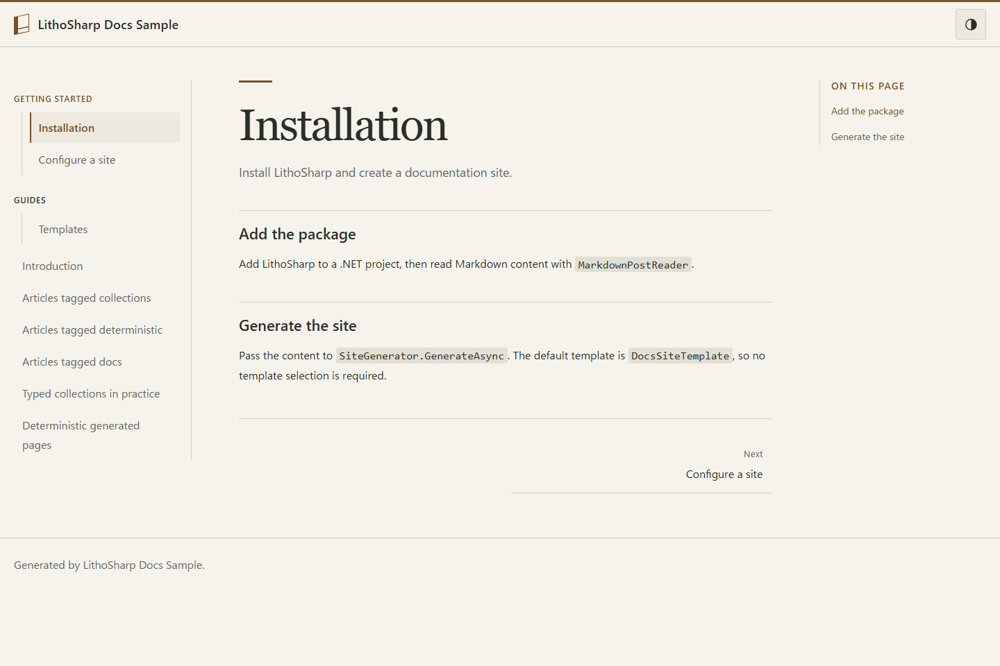
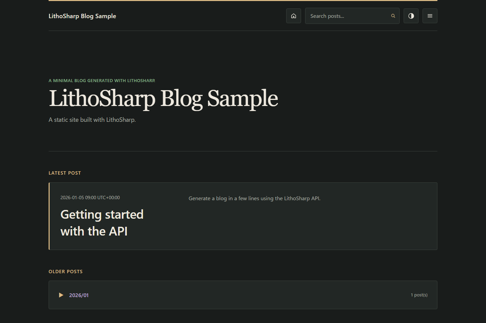

# LithoSharp

[](https://github.com/Htkym/lithosharp/actions/workflows/build.yml)
[](https://www.nuget.org/packages/LithoSharp)

[English](README.md) | [日本語](README.ja.md)

C#の型とビルドで、ドキュメントの整合性を管理します。LithoSharpは、.NETチームの
コンテンツ型、生成した参照、コンパイル診断、生成物の検査をつなぐ静的サイト生成器です。
製品ドキュメントや技術ガイドをMarkdownで書き、必要に応じてMDXやReactを加えられます。
生成物は通常の静的ファイルとして配置できます。

次の三つの問題を、それぞれの工程で検査します。

- 必須のタイトルがない場合は、C#スキーマに基づいてコンパイル時に`LSG006`を報告します。
- entryとルートの矛盾が静的に確定した場合は、Analyzerが`LSA1402`を報告します。
- 最終HTMLにリンク先や見出しがない場合は、生成物の品質検査で`LSQ001`や`LSQ002`を報告します。

検査の対象範囲は工程ごとに異なります。エディターは入力のたびに独自C#スキーマを実行せず、
正しい型付き参照だけで最終HTMLの正しさが確定するわけでもありません。
適合条件、依存関係、評価例は[導入選択ガイド](docs/adoption-guide.ja.md)を参照してください。

このcheckoutは次期マイナーバージョンの候補を説明しており、公開済みのリリースではありません。
型付きDocsを使う場合は、提供された固定候補バージョンとfeedを指定してください。
公開済み2.1.3のDocsテンプレートは従来のreaderを使います。
既存サイトを更新する場合は[更新手順](docs/migration-2.0.ja.md)を参照してください。

## サンプルサイト

同梱のサイト定義から生成した画面です。標準のDocsとBlogは、ライト・ダーク切り替え、
画面幅に応じたメニュー、キーボード操作に対応します。
`SiteThemeOptions.EnableThemeSwitching = false` で切り替えを無効にできます。
詳しくは[テーマの設定](docs/layout-css-contract.md#theme-switching--テーマ切り替え)を参照してください。

| Docsのライト配色 | Blogのダーク配色 |
| --- | --- |
| [](samples/LithoSharp.DocsSample) | [](samples/LithoSharp.Sample) |

## 主な機能

- 型付きC# content collection、route、reference。厳密なschema検証と、任意のRoslyn source generator・build診断。
- Markdownと任意のMDX 3。Reactによる生成時HTML、page hydration、明示islandによるselective hydration。
- Docs、Blog、独立ページ、複数Docs collection、version、locale、sidebar、local search。
- 依存graph、永続cache、invalidation reason、artifact ownershipによる増分ビルドの確認。
- routeとownershipを検証したうえでのstaging、output transaction、公開前のrollback。
- link、anchor、canonical、redirect、SEOに対する構造化診断。
- XML形式の.NET API文書、OpenAPI 3 JSON、正確なxref、検証済みexampleの取り込み。
- site、route、artifact、DOM、component、layoutを検証する.NET向けTesting API。
- fingerprint付きasset、responsive image、C# renderingと信頼するMDX pluginの拡張点。

## Quick Start

.NET 10 SDKを用意して実行します。

提供された候補NuGet feedを設定し、`<candidate-version>`を固定バージョンへ置き換えてください。
生成後はプロジェクトの`LithoSharpVersion`も同じ値にします。

```sh
dotnet new install LithoSharp.ProjectTemplates::<candidate-version>
dotnet tool install LithoSharp.Tool --version <candidate-version> --tool-path .tools
.tools/lithosharp new docs MyDocs -o MyDocs
# ビルド前に MyDocs/MyDocs.csproj の LithoSharpVersion を同じ候補バージョンに設定
.tools/lithosharp build MyDocs -c Release
.tools/lithosharp serve MyDocs -c Release
```

Windowsの実行ファイルは`.tools/lithosharp.exe`です。`GuideFrontMatter.cs`と`MyDocs/content`を
編集します。生成Binder・Catalogのルートと`RenderDocs`がDocs表示につながります。
factoryはQualityのError閾値と外部HTTP検査の無効を明示しています。
`DocsSiteFactory.cs`を設定し、ビルドと検査の後に`MyDocs/dist`を静的HTTP hostへ配置してください。
独立したinstall、Markdown、MDX、対話componentの手順は[Quick Start全体](docs/quickstart.ja.md)を参照してください。

既存アプリケーションでは`dotnet add package LithoSharp --version <candidate-version>`でライブラリを追加し、
直接呼び出せます。CLI hostは必須ではありません。

## 使用例

[型付きコンテンツの体験手順](samples/LithoSharp.DocsSample/README.ja.md#cの型定義から生成物の検査まで)では、正常なDocsサイトを生成し、front matterを一箇所変更して診断を確認した後、元に戻してHTMLとリンクを検査します。同じC#モデルがbinder、型付き参照、サイトのレイアウトにつながっています。

| 問題や情報 | 確認する段階 | 判断できる範囲 |
| --- | --- | --- |
| 必須項目の不足や型の不一致 | Generator/compiler | 明示したコンテンツ入力と、静的に分かるスキーマの条件。 |
| エントリーとルートの矛盾 | Analyzer | 完全で最新のカタログと既知の値。実行時の値は未検証です。 |
| 見出しと原文位置の診断 | Editor/LSP | `NoContext`ではプロジェクトに結び付かず、`Partial`では取得できた情報だけを扱います。 |
| headerや本文の情報を取得できない | Generator・runtime・Editor | `Unknown`は不存在の証明ではありません。解析上限で取得できない情報を成功として扱いません。 |
| 内部URL、anchor、HTML | 生成物検査 | 現在の出力ファイル。原稿との一致や外部HTTP応答は別途確認が必要です。 |

| 目的 | 入口 |
| --- | --- |
| Markdown Docs、typed content、画像 | [Docs sample](samples/LithoSharp.DocsSample) |
| Blog、フィード、検索 | [Blog sample](samples/LithoSharp.Sample) |
| MDX、React island、offline navigation | [MDX sample](samples/LithoSharp.MdxSample/README.ja.md) |
| versioning、i18n、Blog/Pages、API docs | [MDXガイド](docs/mdx.ja.md)と[使用例の案内](docs/quickstart.ja.md#使用例と次の手順) |

Markdownの既定profileは`lithosharp-markdown/1`です。Syntamark 1.2.0が構文と原文範囲を扱い、LithoSharpがC#スキーマ、ルート、表示方針、製品の診断を担当します。解析上限や検証できない状態は[既知の制約](docs/known-limitations.ja.md)を参照してください。

## 必要な環境

.NET 10が必要です。最低対応SDKは10.0.300です。CLIの開発サーバーはSDKに含まれる
ASP.NET Core shared frameworkも使います。MarkdownだけならNode.jsとReactは不要です。
MDXはNode.js 24.13.0と明示的なworker restoreが必要です。lockfileはMDX 3.1.1、React 19.2.4、
esbuild 0.28.2を固定しています。本番出力の配信には静的HTTP hostだけで十分です。

## VS Code拡張機能

[LithoSharp for VS Code](https://marketplace.visualstudio.com/items?itemName=htkym.lithosharp)でMarkdown/MDXの診断、見出しによる移動、ビルド、サイトのプレビューを利用できます。手順は[拡張機能のガイド](extensions/lithosharp-vscode/README.ja.md)を参照してください。

## ドキュメント

[目的別のドキュメント案内](docs/README.ja.md)から、導入、型付きコンテンツ、編集支援、検査、運用のガイドを選べます。英語・日英併記の技術リファレンスも区別しています。

- [Docsの標準設定](docs/docs-template.ja.md)、[生成済み成果物の検査](docs/generated-output-checks.ja.md)
- [CLIとsite factory](docs/cli.ja.md)、[MDXと文書サイト](docs/mdx.ja.md)
- [型付きMarkdown collection](docs/typed-markdown-collections.md)、
  [型付きYAML](docs/typed-yaml-collections.md)、[source generator](docs/source-generators.md)
- [Build graph](docs/build-graph.ja.md)、[増分ビルド](docs/incremental-builds.ja.md)
- [Assetと画像](docs/assets-and-images.ja.md)、[サイト品質](docs/site-quality.md)
- [Testing](docs/testing.ja.md)、[HTML/CSS契約](docs/layout-css-contract.md)、[互換性契約](docs/compatibility-contract.ja.md)

## 2.2候補への更新

利用するパッケージ、CLI、テンプレートは、提供された同じ固定候補バージョンにそろえてください。
2.2候補では新規Docsの構成が変わります。既存サイトは型付きloader、Docs adapter、Quality設定を
明示的に選んで変更します。Catalogのルート宣言で既存URLを維持し、テンプレートを既存ファイルへ
上書きしないでください。[更新手順](docs/migration-2.0.ja.md)を参照してください。
1.xからの更新ではTesting APIの`Document`から`Snapshot`への移行も必要です。
再生成して、コンテンツ診断、最終出力のリンク、独自CSSを確認してください。MDXは任意です。

過去版同士の移行手順は[更新履歴の資料](docs/history/README.md)に保管しています。

## 既知の制約

MDXとC#のsite codeは信頼するbuild codeとして実行します。HTML safetyはコードのsandboxではありません。
大規模MDXでは多くのinteractive entryを再bundleする場合があります。任意のDocusaurus plugin、
trimming、Native AOTは非対応です。実行環境を選ぶ前に[既知の制約](docs/known-limitations.ja.md)を確認してください。

## 性能

性能の測定値は、記載されたパッケージ・ソースのバージョン、入力、測定区間、環境の範囲で
参照してください。生成、Quality、MDX、エディターの検査は、測定する処理が異なります。
無変更ビルドと入力を変更したビルドも分けて確認します。
[測定の根拠・制約・再現手順](docs/performance.ja.md)を参照してください。
一つの入力の結果から、一般的な高速化や移行工数の削減は主張しません。

## 貢献とライセンス

buildと検証の手順は[CONTRIBUTING](CONTRIBUTING.md)を参照してください。
MIT licenseです。[LICENSE](LICENSE)と[third-party notices](THIRD-PARTY-NOTICES.md)も確認してください。
