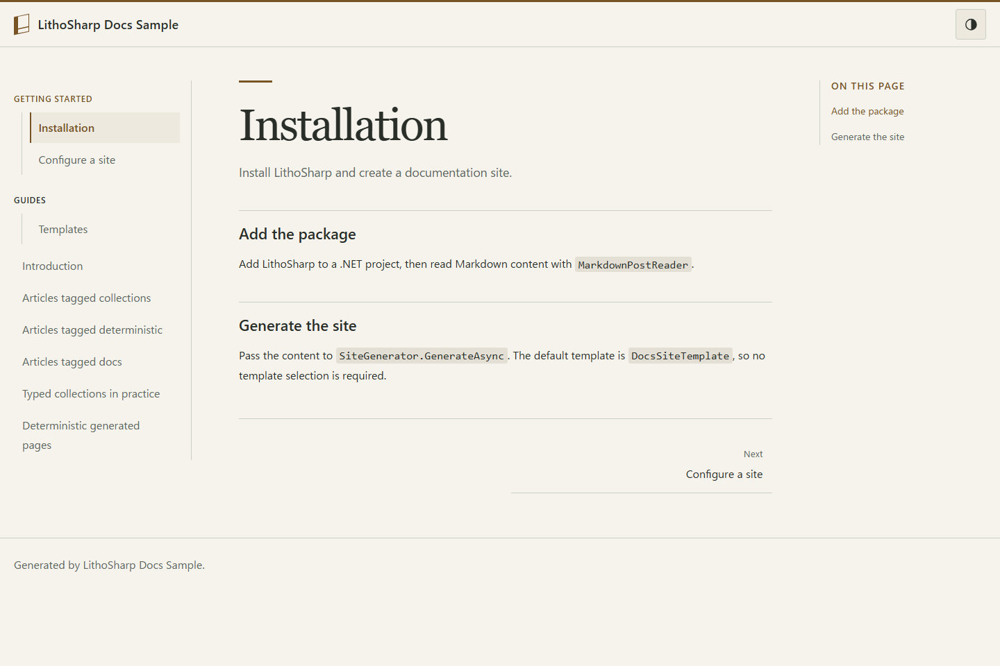
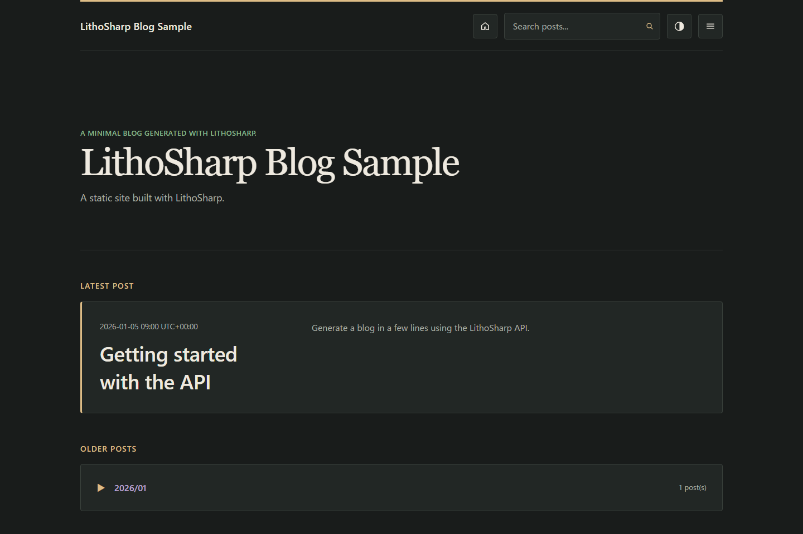

# LithoSharp

[](https://github.com/Htkym/lithosharp/actions/workflows/build.yml)
[](https://www.nuget.org/packages/LithoSharp)

[English](README.md) | 日本語

LithoSharp は技術ドキュメント、API リファレンス、Open Knowledge Format（OKF）バンドル向けの、C# と .NET で使う静的サイトジェネレーターです。コンテンツのスキーマ、ルート、参照を C# の型で定義し、Markdown や MDX から HTML と静的アセットを生成できます。OKF 対応はプレビューです。

| OKF バージョン | 読み込み規則 |
| --- | --- |
| `"0.2"` | 検証記録や日時を含め、従来の 0.2 の規則を使います。 |
| `"0.3"` | 信頼性の判定に使うのは、生成日時以降の検証記録です。日付だけの値は UTC の 0 時として扱い、`/` で始まらないメタデータのパスは文書のディレクトリから解決します。 |

どちらのバージョンも、検証とサイト生成にはバンドルのルートにある `index.md` に引用符付きの `okf_version` が必要です。既存のバンドルに `okf_version: "0.2"` を追加すると、これまでの 0.2 の規則で読み込めます。通常の Markdown にはこの要件を適用しません。

## 主な用途

- 製品ドキュメントや開発者ガイド: Docs テンプレートで、サイドバー、目次、サイト内検索、バージョンや言語の切り替えを備えたサイトを作れます。ブログや独立ページも同じサイトに追加できます。
- 型付きコンテンツと API リファレンス: Markdown や YAML の項目を C# の型で定義できます。.NET の XML API ドキュメント、OpenAPI 3 JSON、検証済みのコード例、相互参照も扱えます。
- OKF バンドル: ローカルにある OKF の Markdown と YAML メタデータを検査・検証できます。元のバイト列を保持してエクスポートすることも、Docs ページとして出力することもできます。モデルや外部サービスは不要です。

用途や依存関係を比較するときは[導入選択ガイド](docs/adoption-guide.ja.md)を参照してください。既存の OKF バンドルを引き継ぐ場合は [4.0 の OKF 移行手順](docs/open-knowledge-format.ja.md)、旧版のサイトを移行する場合は [3.0 への更新手順](docs/migration-3.0.ja.md)を参照してください。

## Quick Start: Docs サイトの生成とプレビュー

.NET 10 SDK（10.0.300 以上）を用意し、4.0.0 で次のコマンドを実行します。

```sh
dotnet new install LithoSharp.ProjectTemplates::4.0.0
dotnet tool install LithoSharp.Tool --version 4.0.0 --tool-path .tools
.tools/lithosharp new docs MyDocs -o MyDocs
.tools/lithosharp build MyDocs -c Release
.tools/lithosharp serve MyDocs -c Release
```

Windows では `.tools/lithosharp.exe` を使ってください。本文は `MyDocs/content`、項目の定義は `GuideFrontMatter.cs`、サイトの設定は `DocsSiteFactory.cs` を編集します。テンプレートは外部 HTTP に接続せず、サイト品質を Error レベルで検査します。ビルドと検査を終えたら `MyDocs/dist` を静的ホストに配置してください。

既存の .NET アプリでは `dotnet add package LithoSharp --version 4.0.0` でライブラリを追加し、直接呼び出せます。環境の準備や Markdown、MDX の使い方は [Quick Start 全体](docs/quickstart.ja.md)を参照してください。

| Docs サンプル（ライト） | Blog サンプル（ダーク） |
| --- | --- |
| [](samples/LithoSharp.DocsSample) | [](samples/LithoSharp.Sample) |

## OKF バンドルの検査と検証

`knowledge/index.md` を作成します。

```markdown
---
okf_version: "0.3"
---
# Knowledge

- [Build process](build.md)
```

`knowledge/build.md` を作成します。

```markdown
---
type: Guide
title: Build process
---
# Build process

Run the documentation build before deployment.
```

`knowledge` の親ディレクトリで次のコマンドを実行します。

```sh
.tools/lithosharp okf inspect --input knowledge --format json
.tools/lithosharp okf validate --input knowledge --format sarif
```

Windows では Quick Start と同じく `.tools/lithosharp.exe` を使ってください。0.3 で相対パスの参照先が文書のディレクトリから見つからなくても、バンドルのルートを再検索しません。

バージョン宣言は読み込み、CLI、サイト生成、新規バンドルの作成に適用されます。エディターの診断と参照の編集には 0.3 の規則が適用されないため、検証には CLI を使ってください。検査やエクスポートで計算を実行したり、実行結果を証明したりすることはありません。詳しくは [OKF ガイド](docs/open-knowledge-format.ja.md)を参照してください。

## 工程ごとの検査

| 工程 | 診断例 | 検査範囲 |
| --- | --- | --- |
| C# コンパイル | コンテンツの必須項目がない（`LSG006`） | 明示された入力とジェネレーターが確認できる条件。 |
| Roslyn Analyzer | 静的に分かるエントリーとルートに矛盾がある（`LSA1402`） | 実行時にしか分からない値は検証しません。 |
| 生成物の検査 | 内部リンクや見出しの参照先がない（`LSQ001` / `LSQ002`） | ビルド済みのファイル。未ビルドの原稿や検査していない外部サイトは対象外です。 |

エディターは構文の診断や見出しへの移動に対応しますが、入力のたびに独自のスキーマを実行するわけではありません。型付き参照が正しくても、最終 HTML の検査は別に必要です。[型付きコンテンツの体験手順](samples/LithoSharp.DocsSample/README.ja.md#cの型定義から生成物の検査まで)や[生成物の検査ガイド](docs/generated-output-checks.ja.md)で確認できます。

## よくある質問

### Node.js や React は必要ですか？

Markdown だけなら不要です。CLI の開発サーバーは .NET SDK に含まれる ASP.NET Core を使います。MDX 3 を使う場合は React、Node.js 24.13.0、MDX ワーカーの明示的な復元が必要です。本番では静的 HTTP ホストで配信できます。C# のサイトコードと MDX は信頼済みのビルドコードとして実行するため、サンドボックスにはなりません。[MDX の設定](docs/mdx.ja.md)と[既知の制約](docs/known-limitations.ja.md)を参照してください。

### Agent Ready の公開機能と OKF はどう違いますか？

[Agent Ready](docs/agent-ready.ja.md) は公開用 Markdown と発見用リンクをサイトに追加する任意の機能です。[OKF 対応](docs/open-knowledge-format.ja.md)ではローカルのOKF バンドルを読み、出典や検証記録などの構造化メタデータを扱います。どちらも検索エンジンや AI による登録や引用を保証するものではありません。

### VS Code から編集できますか？

[LithoSharp for VS Code](https://marketplace.visualstudio.com/items?itemName=htkym.lithosharp) は Markdown と MDX の診断、見出しによる移動、ビルド、サイトのプレビューに対応します。設定方法は[拡張機能のガイド](extensions/lithosharp-vscode/README.ja.md)を参照してください。

## ドキュメントとサンプル

| 目的 | 参照先 |
| --- | --- |
| パッケージや手順を選ぶ | [ドキュメント案内](docs/README.ja.md) |
| Docs のレイアウトやテーマを設定する | [Docs テンプレート](docs/docs-template.ja.md)、[テーマ切り替え](docs/layout-css-contract.md#theme-switching) |
| C# でコンテンツを定義する | [型付き Markdown](docs/typed-markdown-collections.md)、[型付き YAML](docs/typed-yaml-collections.md)、[ソースジェネレーター](docs/source-generators.md) |
| React の部品を追加する | [MDX サンプル](samples/LithoSharp.MdxSample/README.ja.md) |
| ビルドと公開時の変更を調べる | [ビルドグラフ](docs/build-graph.ja.md)、[増分ビルド](docs/incremental-builds.ja.md)、[サイト品質](docs/site-quality.md) |
| サイトのテストと性能測定 | [Testing API](docs/testing.ja.md)、[性能の参考値](docs/performance.ja.md) |
| 既存プロジェクトを更新する | [4.0 の OKF 移行手順](docs/open-knowledge-format.ja.md)、[3.0 への更新手順](docs/migration-3.0.ja.md)、[過去の更新資料](docs/history/README.md) |

MIT ライセンスです。[LICENSE](LICENSE) と[サードパーティー通知](THIRD-PARTY-NOTICES.md)を参照してください。
