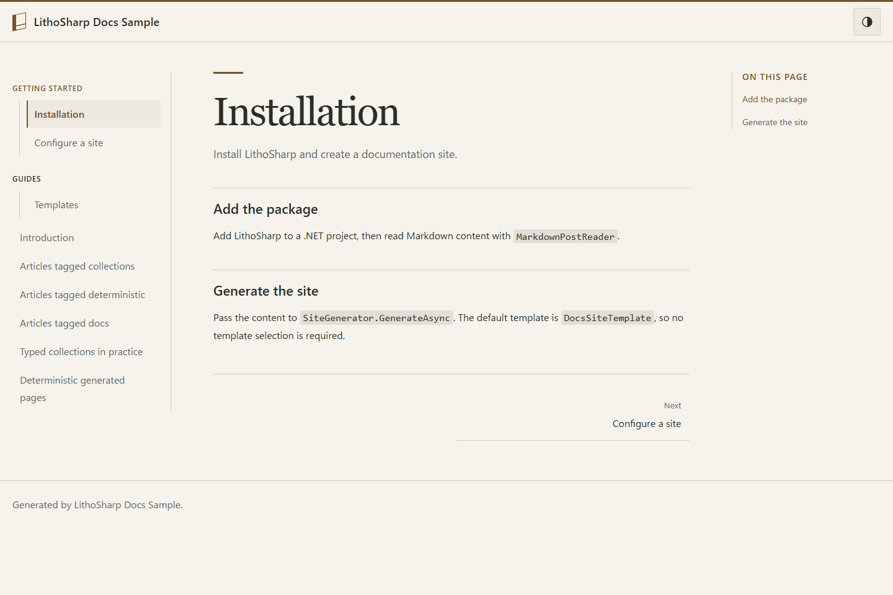
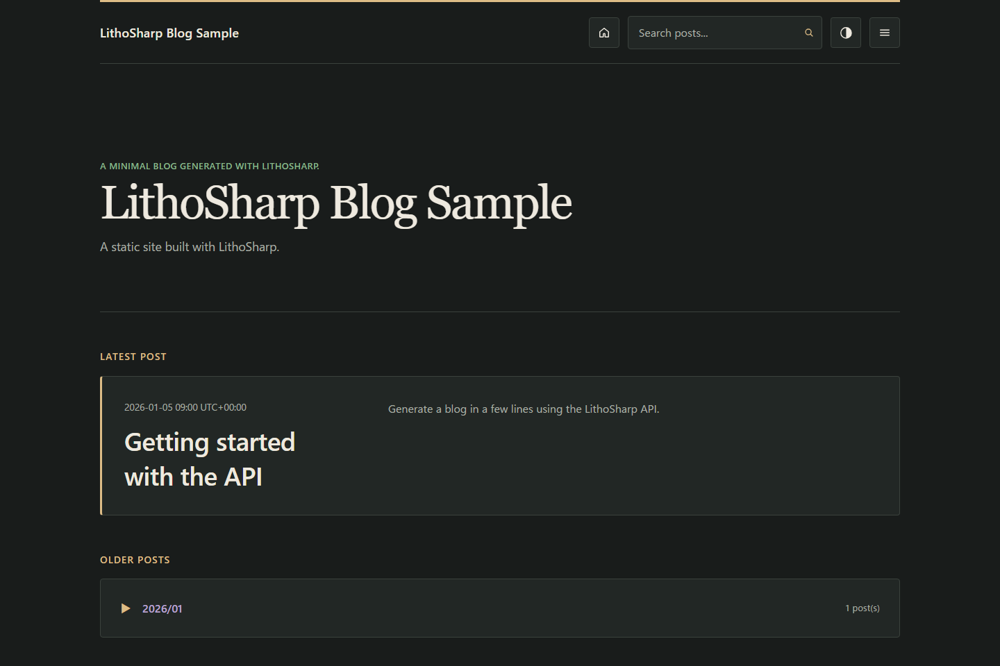

# LithoSharp

[](https://github.com/Htkym/lithosharp/actions/workflows/build.yml)
[](https://www.nuget.org/packages/LithoSharp)

[English](https://github.com/Htkym/lithosharp/blob/main/README.md) | [日本語](https://github.com/Htkym/lithosharp/blob/main/README.ja.md)

A type-safe static site and documentation generator for .NET with C#, Markdown,
MDX, React and incremental builds. Build documentation alongside your .NET code,
validate content and links during generation, and deploy ordinary static files.

The installation examples below use **2.1.3**.
For an existing site, follow the [upgrade guide](https://github.com/Htkym/lithosharp/blob/main/docs/migration-2.0.md).

## Features

- Typed C# content collections, routes and references, with strict schema validation
  and optional Roslyn source generators and build diagnostics.
- Markdown and optional MDX 3 with React, build-time HTML, page hydration and
  selective hydration with explicit islands.
- Docs, Blog and independent pages, multiple Docs collections, versions, locales,
  sidebars and local search.
- Dependency graphs, persistent caches, invalidation reasons and artifact ownership
  for inspectable incremental builds.
- Staged output transactions and rollback before publication, with route and
  ownership validation.
- Structured link, anchor, canonical, redirect and SEO diagnostics.
- XML .NET API documentation, OpenAPI 3 JSON, exact xrefs and checked examples.
- .NET testing APIs for sites, routes, artifacts, DOM, components and layouts.
- Fingerprinted assets, responsive images and explicit extension points for C#
  rendering and trusted MDX plugins.

## Quick Start

With the .NET 10 SDK installed:

```sh
dotnet new install LithoSharp.ProjectTemplates::2.1.3
dotnet tool install LithoSharp.Tool --version 2.1.3 --tool-path .tools
.tools/lithosharp new docs MyDocs -o MyDocs
.tools/lithosharp build MyDocs -c Release
.tools/lithosharp serve MyDocs -c Release
```

On Windows the executable is `.tools/lithosharp.exe`. Edit `MyDocs/content` and
configure `DocsSiteFactory.cs`. Deploy `MyDocs/dist` to a static HTTP host.
For isolated installation, Markdown authoring, MDX and an interactive component,
follow the [complete Quick Start](https://github.com/Htkym/lithosharp/blob/main/docs/quickstart.md).

Existing applications can use `dotnet add package LithoSharp --version 2.1.3`
and call the library directly; a CLI host is not required.

## Sample sites

Generated from the included factories. Both built-in templates support light/dark
switching, responsive menus and keyboard navigation. Set
`SiteThemeOptions.EnableThemeSwitching = false` to disable switching; see
[theme configuration](https://github.com/Htkym/lithosharp/blob/main/docs/layout-css-contract.md#theme-switching--テーマ切り替え).

| Docs — light | Blog — dark |
| --- | --- |
| [](https://github.com/Htkym/lithosharp/tree/main/samples/LithoSharp.DocsSample) | [](https://github.com/Htkym/lithosharp/tree/main/samples/LithoSharp.Sample) |

## Examples

Follow the [typed content walkthrough](https://github.com/Htkym/lithosharp/blob/main/samples/LithoSharp.DocsSample/README.md#from-a-c-model-to-checked-output)
to generate a valid Docs site, change one front matter value to see a compiler
diagnostic, restore it, and inspect the generated HTML and links. The same C#
model connects the binder, typed references and site layout.

| Concern | Checked at | Limits |
| --- | --- | --- |
| Required fields and typed values | Generator/compiler | Explicit content inputs and statically known schema requirements. |
| Entry/route contradictions | Analyzer | Complete, current catalogs and known values; runtime values remain unproven. |
| Headings and source diagnostics | Editor/LSP | `NoContext` has no project binding; `Partial` analysis covers only available facts. |
| Unavailable header or body analysis | Generator/build/editor | `Unknown` or input/resource limits do not establish absence or validity; see the walkthrough for diagnostics and limits. |
| Internal URLs, anchors and HTML | Generated output inspection | Current output artifacts; source freshness and external HTTP responses require separate context/checks. |

Syntamark 1.2.0 owns Markdown syntax and raw source ranges. LithoSharp retains
C# schemas, routes, display policy and product diagnostics; the default profile
remains `lithosharp-markdown/1`. See the [adoption and limits](https://github.com/Htkym/lithosharp/blob/main/docs/migration-2.0.md#package-versions).

| Goal | Start here |
| --- | --- |
| Markdown Docs, typed content and images | [Docs sample](https://github.com/Htkym/lithosharp/tree/main/samples/LithoSharp.DocsSample) |
| Blog, feed and search | [Blog sample](https://github.com/Htkym/lithosharp/tree/main/samples/LithoSharp.Sample) |
| MDX, React islands and offline navigation | [MDX sample](https://github.com/Htkym/lithosharp/blob/main/samples/LithoSharp.MdxSample/README.md) |
| Versioning, i18n, Blog/Pages and API docs | [MDX guide](https://github.com/Htkym/lithosharp/blob/main/docs/mdx.md) and [sample map](https://github.com/Htkym/lithosharp/blob/main/docs/quickstart.md#examples-and-next-steps) |

## Requirements

.NET 10 is required. The minimum supported SDK is 10.0.300. The CLI development
server also uses the ASP.NET Core shared framework provided with the SDK.
Markdown-only sites do not need Node.js or React. MDX requires Node.js 24.13.0
and explicit worker restore; the lockfile pins MDX 3.1.1, React 19.2.4 and
esbuild 0.28.2. Production output needs only a static HTTP host.

## VS Code extension

Install [LithoSharp for VS Code](https://marketplace.visualstudio.com/items?itemName=htkym.lithosharp) for Markdown/MDX diagnostics, heading navigation, build commands and site preview. See the [extension guide](https://github.com/Htkym/lithosharp/blob/main/extensions/lithosharp-vscode/README.md).

## Documentation

Use the [documentation index](https://github.com/Htkym/lithosharp/blob/main/docs/README.md) for an ordered reading path, package choices and the full guide map.

- [Docs template settings](https://github.com/Htkym/lithosharp/blob/main/docs/docs-template.md), [existing output checks](https://github.com/Htkym/lithosharp/blob/main/docs/generated-output-checks.md)
- [CLI and site factories](https://github.com/Htkym/lithosharp/blob/main/docs/cli.md), [MDX and documentation sites](https://github.com/Htkym/lithosharp/blob/main/docs/mdx.md)
- [Typed Markdown collections](https://github.com/Htkym/lithosharp/blob/main/docs/typed-markdown-collections.md),
  [typed YAML](https://github.com/Htkym/lithosharp/blob/main/docs/typed-yaml-collections.md), [source generators](https://github.com/Htkym/lithosharp/blob/main/docs/source-generators.md)
- [Build graph (Japanese)](https://github.com/Htkym/lithosharp/blob/main/docs/build-graph.ja.md), [incremental builds](https://github.com/Htkym/lithosharp/blob/main/docs/incremental-builds.md)
- **Reason**: Every other documentation link in `README.md` targets an English `.md` document, whereas `[Build graph]` points to `docs/build-graph.ja.md` without language indication. If an English `docs/build-graph.md` exists in the repository, update the URL to `docs/build-graph.md` instead; if the build-graph reference is intentionally Japanese-only (mirroring how `README.ja.md` notes English-only and bilingual references), adding `(Japanese)` sets accurate reader expectations without assuming unpublished files.
- [Assets and images](https://github.com/Htkym/lithosharp/blob/main/docs/assets-and-images.md), [site quality](https://github.com/Htkym/lithosharp/blob/main/docs/site-quality.md)
- [Testing](https://github.com/Htkym/lithosharp/blob/main/docs/testing.md), [HTML/CSS contract](https://github.com/Htkym/lithosharp/blob/main/docs/layout-css-contract.md),
  [compatibility contract](https://github.com/Htkym/lithosharp/blob/main/docs/compatibility-contract.md)

## Upgrade to 2.1.3

Update the LithoSharp packages, CLI and templates you use together to 2.1.3.
Docs additions are opt-in; see [template settings](https://github.com/Htkym/lithosharp/blob/main/docs/docs-template.md).
When upgrading from 1.x, follow the [upgrade guide](https://github.com/Htkym/lithosharp/blob/main/docs/migration-2.0.md),
including the Testing API change from `Document` to `Snapshot`. Rebuild your site and check
content warnings, links and custom CSS. MDX remains optional; see the
[supported Markdown syntax](https://github.com/Htkym/lithosharp/blob/main/docs/known-limitations.md#markdown-compatibility).

Notes for migrations between older releases are preserved in the
[upgrade history](https://github.com/Htkym/lithosharp/blob/main/docs/history/README.md).

## Known limitations

MDX and C# site code execute as trusted build code. HTML safety is not a code
sandbox. Large MDX rebuilds can still bundle many interactive entries; arbitrary
Docusaurus plugins, trimming and Native AOT are unsupported. Read
[Known limitations](https://github.com/Htkym/lithosharp/blob/main/docs/known-limitations.md) before choosing an execution environment.

## Performance

In the static-page fixture measured with 0.3.0, selective hydration reduced JS from
449,585 to 15,817 bytes and hydration roots from one to zero. This does not
represent all island or fallback pages. The 10,000-page MDX corpus took 274.30 s
cold and 105.13 s for a no-op. A 100/1,000-page competitor comparison is
summarized alongside the Markdown results remeasured with the 1.0.0 candidate.
See [conditions, limits and reproduction](https://github.com/Htkym/lithosharp/blob/main/docs/performance.md).

## Contribute and license

See [CONTRIBUTING](https://github.com/Htkym/lithosharp/blob/main/CONTRIBUTING.md) for build and verification commands.
MIT licensed; see [LICENSE](https://github.com/Htkym/lithosharp/blob/main/LICENSE) and [third-party notices](https://github.com/Htkym/lithosharp/blob/main/THIRD-PARTY-NOTICES.md).
