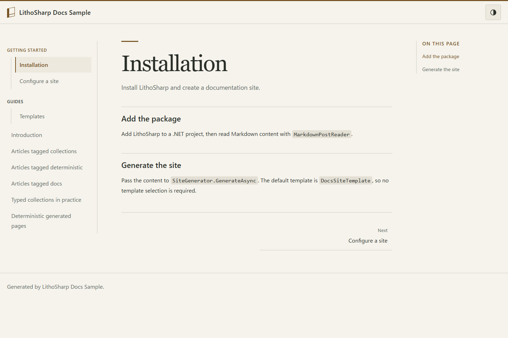
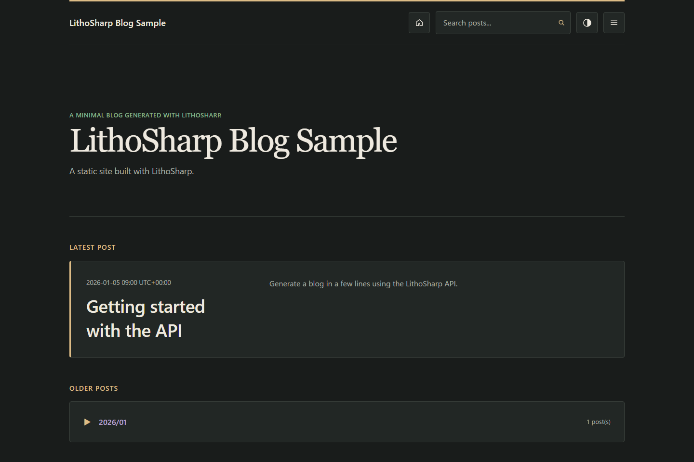

# LithoSharp

[](https://github.com/Htkym/lithosharp/actions/workflows/build.yml)
[](https://www.nuget.org/packages/LithoSharp)

English | [日本語](https://github.com/Htkym/lithosharp/blob/main/README.ja.md)

LithoSharp is a C# and .NET static site generator for technical documentation, API references, and Open Knowledge Format (OKF) bundles. Use C# types to define content schemas, routes, and references; write pages in Markdown or optionally MDX; then build HTML and static assets for an ordinary HTTP host. OKF support is in Preview.

| OKF version | What LithoSharp uses |
| --- | --- |
| `"0.2"` | The existing 0.2 rules, including the previous verification and timestamp behavior. |
| `"0.3"` | Current verification only for trust, date-only metadata at midnight UTC, and document-relative metadata paths unless rooted with `/`. |

For either version, validation and site generation require a quoted `okf_version` in the bundle-root `index.md`. An existing 0.2 bundle can add `okf_version: "0.2"` to keep the previous rules. This requirement does not apply to ordinary Markdown.

## When to use LithoSharp

- **Product documentation and developer guides:** Build a Docs site with sidebars, a table of contents, local search, versions, and locales. Use the Blog template or independent pages alongside Docs.
- **Typed documentation and API references:** Model Markdown or YAML content with C# types and use XML .NET API documentation, OpenAPI 3 JSON, checked examples, and cross-references to keep authored guides connected to generated references.
- **Knowledge bundles:** Inspect and validate local OKF Markdown and YAML metadata, preserve original bundle bytes, or render documents through the Docs pipeline. No model or external service is required.

Start with the [adoption guide](https://github.com/Htkym/lithosharp/blob/main/docs/adoption-guide.md) if you are evaluating fit, the [4.0 OKF migration instructions](https://github.com/Htkym/lithosharp/blob/main/docs/open-knowledge-format.md#declare-the-bundle-version) if you have an existing OKF bundle, or the [3.0 migration guide](https://github.com/Htkym/lithosharp/blob/main/docs/migration-3.0.md) if you are migrating a site from an older release.

## Quick Start: build and serve a Docs site

Install the .NET 10 SDK (minimum **10.0.300**), then run these commands for **4.0.0**:

```sh
dotnet new install LithoSharp.ProjectTemplates::4.0.0
dotnet tool install LithoSharp.Tool --version 4.0.0 --tool-path .tools
.tools/lithosharp new docs MyDocs -o MyDocs
.tools/lithosharp build MyDocs -c Release
.tools/lithosharp serve MyDocs -c Release
```

On Windows use `.tools/lithosharp.exe`. Edit `MyDocs/content` and `GuideFrontMatter.cs` to define your content. Configure the site in `DocsSiteFactory.cs`. The template checks site quality at Error severity without external HTTP requests. Build and check the site, then deploy `MyDocs/dist` to your static host.

Existing .NET apps can install the library with `dotnet add package LithoSharp --version 4.0.0` and call it directly. See the [full Quick Start](https://github.com/Htkym/lithosharp/blob/main/docs/quickstart.md) for setup, Markdown authoring, and optional MDX components.

| Docs sample, light theme | Blog sample, dark theme |
| --- | --- |
| [](https://github.com/Htkym/lithosharp/tree/main/samples/LithoSharp.DocsSample) | [](https://github.com/Htkym/lithosharp/tree/main/samples/LithoSharp.Sample) |

## Inspect an OKF bundle

Create `knowledge/index.md`:

```markdown
---
okf_version: "0.3"
---
# Knowledge

- [Build process](build.md)
```

Create `knowledge/build.md`:

```markdown
---
type: Guide
title: Build process
---
# Build process

Run the documentation build before deployment.
```

Run the CLI from the directory containing `knowledge`:

```sh
.tools/lithosharp okf inspect --input knowledge --format json
.tools/lithosharp okf validate --input knowledge --format sarif
```

As in Quick Start, use `.tools/lithosharp.exe` on Windows. A bare 0.3 metadata path is not retried at the bundle root if it cannot be resolved from the containing document.

The bundle reader, CLI, site generation, and writer use the selected OKF version. Live editor diagnostics and reference edits are not authoritative for 0.3; validate the bundle with the CLI. OKF inspection and export do not run computations or verify runtime attestations. See the [OKF guide](https://github.com/Htkym/lithosharp/blob/main/docs/open-knowledge-format.md) for diagnostics, preservation, and version-specific behavior.

## What gets checked?

| Stage | Example | Boundary |
| --- | --- | --- |
| C# compilation | A required content field is missing (`LSG006`). | Checks explicit inputs and requirements known to the generator. |
| Roslyn analyzer | A statically known entry and route disagree (`LSA1402`). | Does not prove values known only at runtime. |
| Generated output | An internal link or heading target is missing (`LSQ001` / `LSQ002`). | Checks built artifacts, not unbuilt source or unchecked external sites. |

The editor can report source syntax and support navigation without running your custom schema on every keystroke. A valid typed reference does not certify the final HTML. Try the [typed content walkthrough](https://github.com/Htkym/lithosharp/blob/main/samples/LithoSharp.DocsSample/README.md#from-a-c-model-to-checked-output) or read the [generated-output checks guide](https://github.com/Htkym/lithosharp/blob/main/docs/generated-output-checks.md).

## FAQ

### Do I need Node.js, React, or a server runtime?

No for Markdown-only authoring. The CLI development server uses ASP.NET Core from the .NET SDK. Optional MDX 3 uses React and requires Node.js **24.13.0** plus an explicit worker restore. Production output is served by a static HTTP host. C# site code and MDX run as trusted build code, not in a sandbox. See [MDX setup](https://github.com/Htkym/lithosharp/blob/main/docs/mdx.md) and [known limitations](https://github.com/Htkym/lithosharp/blob/main/docs/known-limitations.md).

### How is Agent Ready publishing different from OKF?

[Agent Ready publishing](https://github.com/Htkym/lithosharp/blob/main/docs/agent-ready.md) optionally exposes public Markdown with stable URLs and discovery links alongside the site. [OKF support](https://github.com/Htkym/lithosharp/blob/main/docs/open-knowledge-format.md) reads local knowledge bundles and their structured metadata, such as sources and verification records. Neither feature guarantees indexing or citations by a search engine or AI system.

### Can I author in VS Code?

[LithoSharp for VS Code](https://marketplace.visualstudio.com/items?itemName=htkym.lithosharp) supports Markdown/MDX diagnostics, heading navigation, builds, and site previews. See the [extension guide](https://github.com/Htkym/lithosharp/blob/main/extensions/lithosharp-vscode/README.md).

## Documentation and examples

| Goal | Start here |
| --- | --- |
| Choose packages and guides | [Documentation index](https://github.com/Htkym/lithosharp/blob/main/docs/README.md) |
| Configure Docs layout and themes | [Docs template](https://github.com/Htkym/lithosharp/blob/main/docs/docs-template.md), [theme switching](https://github.com/Htkym/lithosharp/blob/main/docs/layout-css-contract.md#theme-switching) |
| Model content in C# | [Typed Markdown](https://github.com/Htkym/lithosharp/blob/main/docs/typed-markdown-collections.md), [typed YAML](https://github.com/Htkym/lithosharp/blob/main/docs/typed-yaml-collections.md), [source generators](https://github.com/Htkym/lithosharp/blob/main/docs/source-generators.md) |
| Add React components | [MDX sample](https://github.com/Htkym/lithosharp/blob/main/samples/LithoSharp.MdxSample/README.md) |
| Inspect builds and deployment changes | [Build graph](https://github.com/Htkym/lithosharp/blob/main/docs/build-graph.md), [incremental builds](https://github.com/Htkym/lithosharp/blob/main/docs/incremental-builds.md), [site quality](https://github.com/Htkym/lithosharp/blob/main/docs/site-quality.md) |
| Test sites and check performance | [Testing](https://github.com/Htkym/lithosharp/blob/main/docs/testing.md), [reference measurements](https://github.com/Htkym/lithosharp/blob/main/docs/performance.md) |
| Upgrade an existing project | [4.0 OKF migration](https://github.com/Htkym/lithosharp/blob/main/docs/open-knowledge-format.md#declare-the-bundle-version), [3.0 migration guide](https://github.com/Htkym/lithosharp/blob/main/docs/migration-3.0.md), [older upgrade history](https://github.com/Htkym/lithosharp/blob/main/docs/history/README.md) |

MIT licensed. See [LICENSE](https://github.com/Htkym/lithosharp/blob/main/LICENSE) and [third-party notices](https://github.com/Htkym/lithosharp/blob/main/THIRD-PARTY-NOTICES.md).
