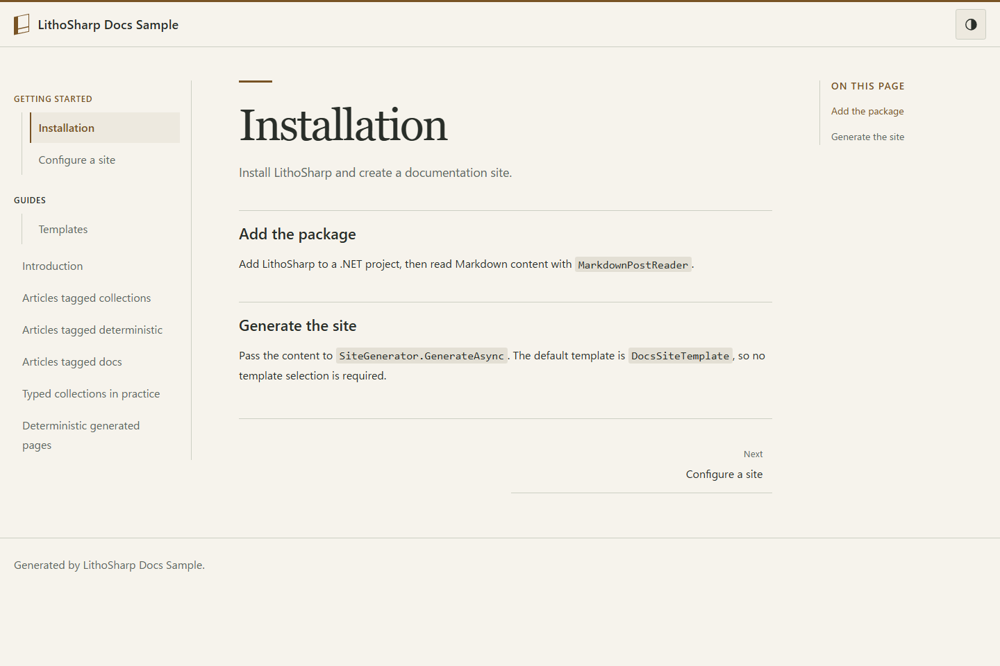

# LithoSharp Docs サンプル

[English](README.md)



テーマ切り替えは既定で有効です。`SiteThemeOptions.EnableThemeSwitching = false`で無効にできます。
[固定ダーク配色を含む設定例](../../docs/layout-css-contract.ja.md#テーマ切り替え)を参照してください。

[LithoSharp](../../src/LithoSharp)、型付きの記事コレクション、生成された参照、トピックインデックスで文書をビルドするコンソールアプリです。
既定の`DocsSiteTemplate`を使います。このチェックアウトはLithoSharp 3.0.0を対象にしています。
選定したSyntamarkの組み合わせと公開状態は[バージョン一覧](../../eng/version-matrix.json)に記録しています。
候補の検証は、パッケージの正式公開を証明するものではありません。

## 実行方法

.NET 10 SDKの対応する機能バンド（10.0.300以降）を使い、リポジトリのルートで実行してください。
MarkdownだけのサンプルなのでNode.jsは不要です。プロジェクト参照を使っています。
パッケージを使う場合は[Quick Start](../../docs/quickstart.ja.md)から始められます。

```powershell
dotnet run --project samples/LithoSharp.DocsSample -- --check --output _site
```

- `--output <dir>`: サイトの出力先です。既定値は`./_site`です。
- `--content <dir>`: Markdownのソースフォルダーです。既定値はアプリのそばに同梱した`content/`です。
- `--check`: 出力のコミット前に、生成したHTML、ローカルリンク、アンカーを検査します。
- `--asset-demo`: 公開ファイルとPNGのレスポンシブ画像を含めます。
- `--redirect-demo`: 検査対象の`old-home.html`リダイレクトを追加します。

プログラムはクリーン生成と、その後の増分生成を行い、キャッシュのヒット数とミス数を表示します。
`--check`を指定すると両方で品質を検査します。検証済みのno-opビルドでは、ステージングをやり直さずに既存の出力を検査できます。

ブラウザーで開く前に出力をHTTPで配信してください。後の手順にCLIコマンドがあります。
HTMLファイルを直接開くと、サイトルートからのリンクを正しく解決できません。
ディレクトリがサイドバーの節になり、Markdownのfront matterの`sidebar_position`と`sidebar_label`でページの順序とラベルを制御します。

## C#の型定義から生成物の検査まで

次のコマンドはリポジトリのルートで実行してください。
同じ[`ArticleFrontMatter`モデル](SampleModels.cs)を、生成したバインダー、[`typed-content/`](typed-content/)のコンパイル時入力、
実行時の読み込み、記事レイアウトで使います。`GeneratedArticles`はコレクションのカタログと型付き参照を提供します。
レイアウトは生成した参照で2件目の記事へリンクし、トピックページは読み込んだエントリーを使います。
GeneratorとAnalyzerはコンパイル時だけの依存関係です。

[`AdditionalFiles`の宣言](LithoSharp.DocsSample.csproj)はコレクション、エントリーID、ルートをコンパイルへ渡します。
[`SiteFactory.cs`](SiteFactory.cs)は、読み込みに`GeneratedArticles.Binder`、
関連記事のリンクに`GeneratedArticles.Entries.Typed_Content_Second.GetUrl(context.Site.BaseUrl)`を使います。
IDとルートはコンパイラーの検査と同じ宣言に基づきます。
自分のサイトへ適用する場合は[Generatorの設定](../../docs/source-generators.ja.md)を参照してください。

1. 正常なサイトを生成し、出力を検査します。

   ```powershell
   dotnet run --project samples/LithoSharp.DocsSample -- --check --output .local/docs-walkthrough
   dotnet run --project src/LithoSharp.Tool -- check-output --output .local/docs-walkthrough --base-url https://example.com/ --format json
   ```

   `--check`はステージング中の生成結果を検査し、`check-output`はサイトを生成せずに現在のファイルを読み取ります。
   サイトルートからのリンクをたどるには、開発サーバーを起動してください。この操作は、信頼して実行するサンプルファクトリをビルドします。

   ```powershell
   dotnet run --project src/LithoSharp.Tool -- serve samples/LithoSharp.DocsSample --output .local/docs-walkthrough --port 4328
   ```

   <http://127.0.0.1:4328/articles/first/>を開き、型付き参照で作った記事リンクをたどります。
   ファイルを`file://`で開かず、HTTPを使ってください。次の手順で意図的にコンパイルエラーを起こす前に、Ctrl+Cでサーバーを停止してください。

2. `samples/LithoSharp.DocsSample/typed-content/first.md`から`title:`の行だけを削除し、サンプルをビルドします。

   ```powershell
   dotnet build samples/LithoSharp.DocsSample
   ```

   C#の必須メンバーに対応する値がないため、サイト生成前に`LSG006`が出ます。
   行を戻してから`published_from`を`not-a-date`に変えると、型変換の診断を確認できます。
   [missing-title.md](examples/missing-title.md)と[wrong-type.md](examples/wrong-type.md)は、それぞれの不正な入力を示す例です。
   通常のコンテンツとコンパイル時入力の外に置いています。

3. front matterを元に戻し、`--check`を付けて再生成します。
   エディターで`samples/LithoSharp.DocsSample/typed-content/first.md`を開き、見出しのアウトラインや診断位置をたどってください。
   [VS Code拡張](../../extensions/lithosharp-vscode/README.ja.md)が編集を支援します。
   プロジェクトの文脈がない構文上の移動機能では、プロジェクトに結び付いたスキーマやサイトのルートを確定できません。
   明示的なBuildやInspectで取得した最新のスナップショットに生成された静的スキーマがあれば、フィールドの検証、補完、ホバーに使えます。
   エディターはC#バインダーや独自の検証コードを実行せず、静的スキーマだけでは実行時のバインド全体を証明しません。
   詳しくは[プロジェクトの文脈の契約](../../docs/language-server.ja.md)を参照してください。
   Markdownのアウトラインの選択先は見出しで、シンボルの範囲にはセクション全体を使います。
   MDXは別の見出しベースのアウトラインを使い、このMarkdownのセクション範囲の契約は引き継ぎません。

参照の矛盾を試すには、[conflicting-reference.cs.txt](examples/conflicting-reference.cs.txt)を
サンプル内へ`ConflictingReferenceExample.cs`としてコピーし、ビルドしてください。
同じ完全で最新のカタログ内で、宣言済みの`first.md`と異なるルートを組み合わせた矛盾を`LSA1402`が示します。
通常のリンクには生成された参照を使ってください。確認後は一時的な`.cs`ファイルを削除します。
[dynamic-reference.cs.txt](examples/dynamic-reference.cs.txt)はルートを実行時に受け取るため、コンパイラーでは値を証明できません。
矛盾の診断がないことは、ルートが正しいという証明にはなりません。

生成後の問題を試すには、生成した`articles/first/index.html`の`</body>`の前へ
[broken-output.html](examples/broken-output.html)を挿入し、`check-output`を再実行してください。
内部の参照先がないため`LSQ001`が出ます。サイトを再生成してファイルを元に戻してください。
この検査は実際の出力バイト列を読み取りますが、配布物が現在のソースと一致することは証明しません。
詳しくは[生成済み出力の検査](../../docs/generated-output-checks.ja.md)を参照してください。

| 問題や情報 | 段階 | 判断できる範囲 |
| --- | --- | --- |
| 必須のtitleの不足や不正な日付 | Generator: `LSG006` | 明示したコンパイル時入力の必須項目や型変換のエラーです。動的に見つかったファイルは検証しません。 |
| 既知のエントリーIDと異なる宣言済みルートの組み合わせ | Analyzer: `LSA1402` | 完全で最新のカタログ（`Closed`）内の矛盾です。動的な値は未検証です。 |
| 見出しと原文位置の診断 | Editor/LSP | 現在の文書の構文と、適用できる場合は明示的に取得した静的なプロジェクトのデータを使います。`NoContext`ではプロジェクト、スキーマ、ルートの検査はできません。静的スキーマだけでは実行時のバインド全体を証明しません。 |
| 不完全な解析（`Partial`） | 解析・編集中 | 取得できた情報だけを使います。情報がないことから、コンテンツの不存在や妥当性は判断できません。 |
| 入力や解析資源の上限による情報の取得不能 | Editor: `LSM013` | 解析が停止しており、取得できない情報は未検証です。入力の上限は8 Mi UTF-16コード単位です。 |
| 解析対象の記事本文の情報を取得不能 | 生成: `LSM013` | 本文入力の上限は1 Mi UTF-16コード単位です。失敗時は公開を停止し、以前の出力を保ちます。描画だけの断片はこの解析経路を使いません。 |
| ヘッダーの区切りを取得不能 | Generator: `LSG002`、runtime: `LSM013` | ヘッダー専用走査の上限は1 Mi UTF-16コード単位です。`Unknown`からヘッダーの不存在や未閉鎖は確定できません。閉じ区切り後の本文は上限に含めません。 |
| 生成物の内部参照先やアンカーの不足 | 生成時の品質検査・`check-output`: `LSQ001`/`LSQ002` | 検査したローカル成果物での、参照先やアンカーの不足です。検査に通っても、調べたローカル成果物とアンカーの存在しか確認できません。外部HTTP検査は既定で無効です。 |

## このサンプルで示すもの

- 既定のDocsテンプレート。
- 明示的に選んだ文書用プロファイルと、登録した型付きの`version-badge` Markdownコンポーネント。
- 石版をイメージした文字組とライト・ダークの配色。ヘッダーの切り替え操作は読者の選択を保存し、未選択の場合はOSの配色設定に従います。
- サイドバーの階層を作る入れ子のコンテンツフォルダー。
- front matterの`sidebar_position`と`sidebar_label`。
- ページの目次と前後の文書へのリンク。

従来のブログレイアウトは[`samples/LithoSharp.Sample`](../LithoSharp.Sample)を参照してください。

サンプルは`DocsSampleFactory : ISiteFactory`を公開します。CLIからも、同じMarkdownと独自のC#記事レイアウトをビルドできます。

```sh
lithosharp build samples/LithoSharp.DocsSample -o artifacts/docs-cli
lithosharp serve samples/LithoSharp.DocsSample
```

通常の`dotnet run`のエントリーポイントも同じファクトリを呼び出します。
既存の`--content`、`--output`、`--check`、`--redirect-demo`、`--asset-demo`は引き続き使えます。
ファクトリはソースパスの基準にプロジェクトのコンテキストを使います。

## ファクトリのテスト

サンプルのファクトリとSiteTestHostを使い、SiteTestDocumentでDOMを表明します。
ホストは出力とキャッシュを隔離し、外部リンクの検査を設定しない限りネットワークは使いません。

```csharp
using LithoSharp;
using LithoSharp.Testing;

await using var host = await SiteTestHost.CreateAsync(
    new DocsSampleFactory { AssetDemo = true },
    new SiteFactoryContext(Path.GetFullPath("samples/LithoSharp.DocsSample")));
host.AssertSucceeded();
host.AssertRoute("/index.html", "index.html");
using var page = await host.OpenPageAsync("/index.html");
page.AssertElement("main");
```

テストプロジェクトからこのサンプルと`LithoSharp.Testing`を参照し、例をリポジトリのルートで実行してください。
`AssetDemo = true`でPNG処理と独自の記事レイアウトを試せます。
構造化されたルート、ビルド計画、品質の検証に失敗した場合は、診断を保持し、`Succeeded = false`、`Result = null`になります。
ファクトリ、描画、I/O、キャンセルの例外は呼び出し側へ伝播します。
診断やエラー条件は[テストガイド](../../docs/testing.ja.md)と[この日本語のサンプル案内](README.ja.md)を参照してください。
