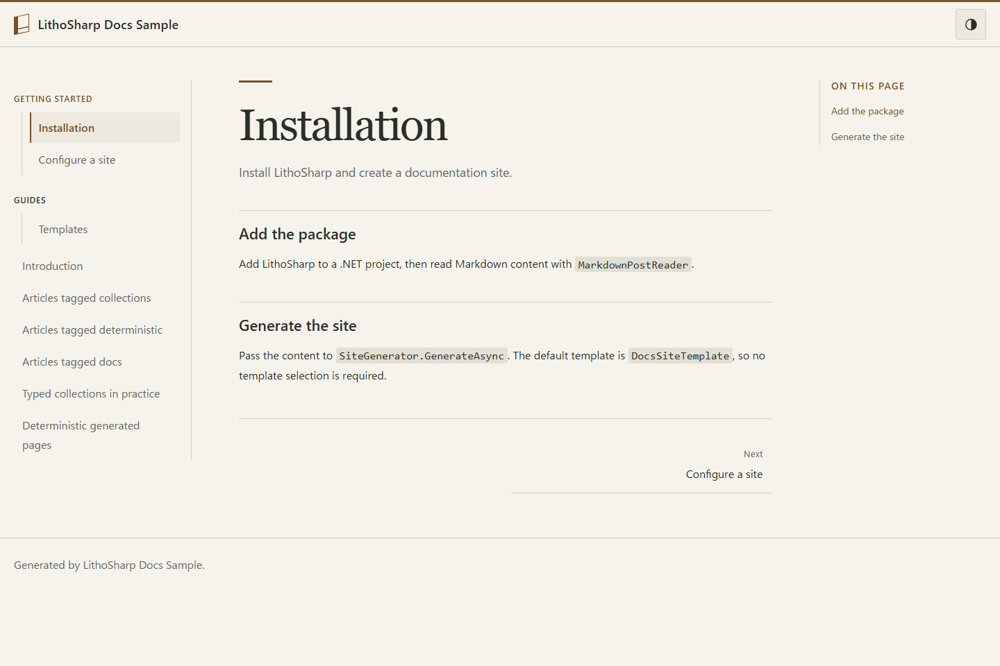

# LithoSharp Docs sample



Theme switching is enabled by default. Set `SiteThemeOptions.EnableThemeSwitching = false`
to disable it; see the [configuration and fixed dark example](../../docs/layout-css-contract.md#theme-switching--テーマ切り替え).

A minimal console app that builds documentation with
[LithoSharp](../../src/LithoSharp). It uses the default `DocsSiteTemplate`.

## Run it

```powershell
dotnet run --project samples/LithoSharp.DocsSample -- --check --output _site
```

- `--output <dir>`: where the site is written (default: `./_site`).
- `--content <dir>`: Markdown source folder (default: the bundled `content/` next to the app).
- `--check`: inspect generated HTML, local links and anchors before committing output.

Open `_site/index.html` in a browser. Directories create sidebar sections, and
`sidebar_position` and `sidebar_label` in Markdown front matter control page order
and labels.

## From a C# model to checked output

Run the commands below from the repository root with the .NET 10 SDK. The same
`ArticleFrontMatter` model drives the generated binder, static compiler inputs in
`typed-content/`, runtime loading and the article layout. `GeneratedArticles`
provides the collection catalog and typed references. The layout links to the
second article through its generated reference, and topic pages use the loaded
entries. The generator and analyzer are compiler-only dependencies.

1. Generate a valid site and inspect its output:

   ```powershell
   dotnet run --project samples/LithoSharp.DocsSample -- --check --output .local/docs-walkthrough
   dotnet run --project src/LithoSharp.Tool -- check-output --output .local/docs-walkthrough --base-url https://example.com/ --format json
   ```

   Open `.local/docs-walkthrough/articles/first/index.html` and follow the typed
   article link. `--check` checks the staged generation; `check-output` reads the
   current files without generating a site.

2. Remove only the `title:` line from `typed-content/first.md` and build the sample:

   ```powershell
   dotnet build samples/LithoSharp.DocsSample
   ```

   The required C# member produces `LSG006` before site generation. Restore the
   line, then change `published_from` to `not-a-date` to see a type conversion
   diagnostic. [missing-title.md](examples/missing-title.md) and
   [wrong-type.md](examples/wrong-type.md) contain these isolated invalid examples.
   They are outside normal content and compiler inputs.

3. Restore the valid front matter and generate again with `--check`. In the editor,
   open `typed-content/first.md`, use the heading outline, and follow diagnostic
   locations. The [VS Code extension](../../extensions/lithosharp-vscode/README.md)
   supplies editing support. Syntax navigation without project context does not
   validate this custom C# schema or establish site routes; the compiler and site
   build provide those checks.

To try a proven reference mismatch, copy
[conflicting-reference.cs.txt](examples/conflicting-reference.cs.txt) into the
sample as `ConflictingReferenceExample.cs` and build. `LSA1402` identifies the
declared `first.md` entry paired with a different route in the same complete,
current catalog. Prefer generated references for ordinary links. Remove the
temporary `.cs` file after the exercise.
[dynamic-reference.cs.txt](examples/dynamic-reference.cs.txt) passes its route in
at runtime: the compiler cannot prove its value. An absent contradiction
diagnostic does not establish that the route is valid.

For a problem introduced after generation, insert
[broken-output.html](examples/broken-output.html) before `</body>` in the generated
`articles/first/index.html`, then repeat `check-output`. It reports `LSQ001` for
the missing internal target. Regenerate the site to restore the file. This check
uses actual output bytes and cannot prove that a distribution matches current
sources; see [generated output checks](../../docs/generated-output-checks.md).

| Problem or information | Stage | What is established |
| --- | --- | --- |
| Missing required title or invalid date | Generator: `LSG006` | The explicit Markdown inputs agree with the C# schema. |
| Known entry ID paired with the wrong declared route | Analyzer: `LSA1402` | A contradiction in a complete, current catalog (`Closed`). Dynamic values remain unproven. |
| Headings and source diagnostics | Editor/LSP | Syntax information for the current document. `NoContext` means project/schema/route checks are unavailable. |
| Incomplete analysis (`Partial`) | Parsing or editing | Only available facts can be used; missing facts are not evidence that content is absent or valid. |
| Missing internal output target or anchor | Generation quality checks or `check-output`: `LSQ001`/`LSQ002` | The inspected local artifacts and anchors exist. External HTTP checks are off by default. |

CI builds the normal sample, runs it with `--check`, and exercises these published
invalid inputs through the generator, analyzer and generated-output
inspector. The checks assert diagnostic IDs and stages, not only a failed process.
Markdown syntax and raw source ranges belong to Syntamark; C# schemas, routes,
display policy and product diagnostics belong to LithoSharp. The default Markdown
profile remains `lithosharp-markdown/1`.

## What it shows

- The default Docs template.
- Stone-inspired typography and light/dark palettes. The header toggle saves the
  reader's choice; otherwise the site follows the operating system's preference.
- Nested content folders for the sidebar hierarchy.
- `sidebar_position` and `sidebar_label` front matter.
- The page table of contents and previous/next document links.

For the legacy blog layout, see
[`samples/LithoSharp.Sample`](../LithoSharp.Sample).

The sample exports `DocsSampleFactory : ISiteFactory`. The CLI can build the same
Markdown and custom C# article layout with:

```sh
lithosharp build samples/LithoSharp.DocsSample -o artifacts/docs-cli
lithosharp serve samples/LithoSharp.DocsSample
```

The normal `dotnet run` entry point calls the same factory. Its existing
`--content`, `--output`, `--check`, `--redirect-demo`, and `--asset-demo` switches
remain available. The factory uses its project context for source paths.

このサンプルは `DocsSampleFactory` を公開しています。CLI と通常の C# 実行が
同じサイト定義と記事レイアウトを使います。既存のサンプル用オプションも利用できます。

## Testing

Use SiteTestHost with the sample factory and SiteTestDocument for DOM assertions. The host isolates output and caches and does not use the network unless external link checks are configured.

```csharp
using LithoSharp;
using LithoSharp.Testing;

await using var host = await SiteTestHost.CreateAsync(
    new DocsSampleFactory { AssetDemo = true },
    new SiteFactoryContext(Path.GetFullPath("samples/LithoSharp.DocsSample")));
host.AssertSucceeded();
host.AssertRoute("/index.html", "index.html");
using var page = await host.OpenPageAsync("/index.html");
page.AssertElement("main");
```

Reference this sample project and `LithoSharp.Testing` from your test project, and
run the example from the repository root. See the [testing guide](../../docs/testing.md)
and [Japanese sample notes](README.ja.md) for diagnostics and error conditions.
