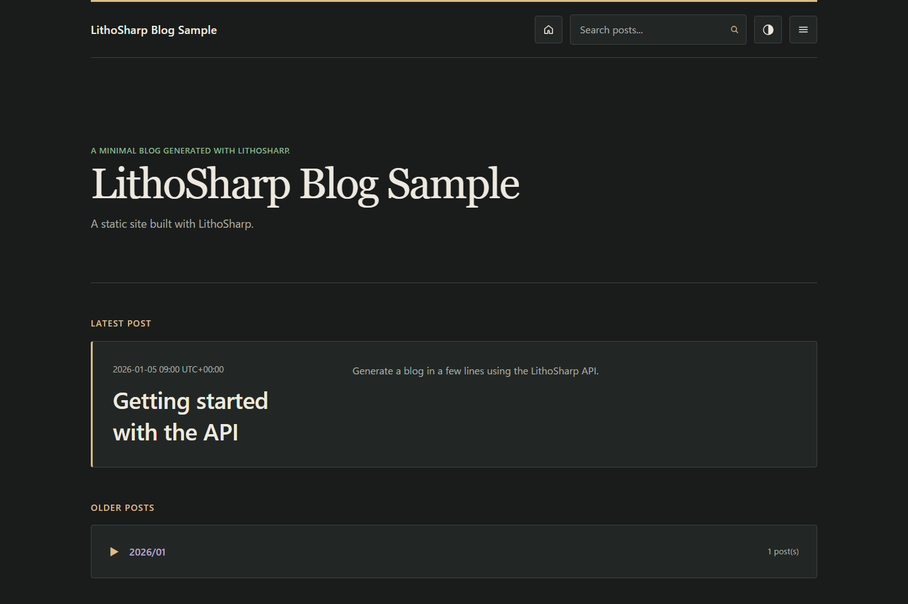

# LithoSharp Blog サンプル



テーマ切り替えは既定で有効です。`SiteThemeOptions.EnableThemeSwitching = false` で無効にできます。
[固定ダーク配色を含む設定例](../../docs/layout-css-contract.md#theme-switching--テーマ切り替え)を参照してください。

記事一覧・本文・アーカイブ・タグ・検索を備えたブログテンプレートです。
見出しと余白を重視したレイアウトを採用しており、ライト・ダークの配色を切り替えられます。
初回はOS設定に従い、ヘッダーから選んだ配色をブラウザーに保存します。

## 実行

.NET 10 SDKを使い、リポジトリのルートで実行します。

```powershell
dotnet run --project samples/LithoSharp.Sample -- --check --output .local/blog-sample
```

`.local/blog-sample/index.html`を開いて確認してください。`--output <dir>`は出力先、`--content <dir>`はMarkdown入力先を指定します。省略時の出力先は`./_site`、入力先はアプリと同梱する`content/`です。`--check`では公開前に品質を検査し、`--redirect-demo`ではリダイレクトの例を有効にします。

このサンプルは`MarkdownPostReader`で読み込んだ記事を`BlogSiteTemplate`で生成します。faviconとsocial imageの資産は任意で、faviconのディレクトリを指定しなくてもHTMLを生成できます。標準Docsのレイアウトや型付き参照は[Docsサンプル](../LithoSharp.DocsSample/README.ja.md)を参照してください。

`BlogSampleFactory : ISiteFactory`を公開しているため、`lithosharp build samples/LithoSharp.Sample -o artifacts/blog-cli`でも同じサイトを生成できます。

`BlogSampleFactory` は通常実行とテストで同じサイト定義を返します。
テストプロジェクトからこのサンプルと `LithoSharp.Testing` を参照し、
次の例をリポジトリのルートで実行します。既存のサンプル用コマンドライン
オプションも利用できます。

## ファクトリのテスト

```csharp
using LithoSharp;
using LithoSharp.Testing;

await using var host = await SiteTestHost.CreateAsync(
    new BlogSampleFactory(),
    new SiteFactoryContext(Path.GetFullPath("samples/LithoSharp.Sample")));
host.AssertSucceeded();
host.AssertRoute("/index.html", "index.html");
using var page = await host.OpenPageAsync("/index.html");
page.AssertElement("main");
```

出力先とキャッシュは隔離され、外部リンクの検証は既定で無効です。
成果物と診断の検証、失敗時の扱いについては、
[テストガイド](../../docs/testing.ja.md)を参照してください。
