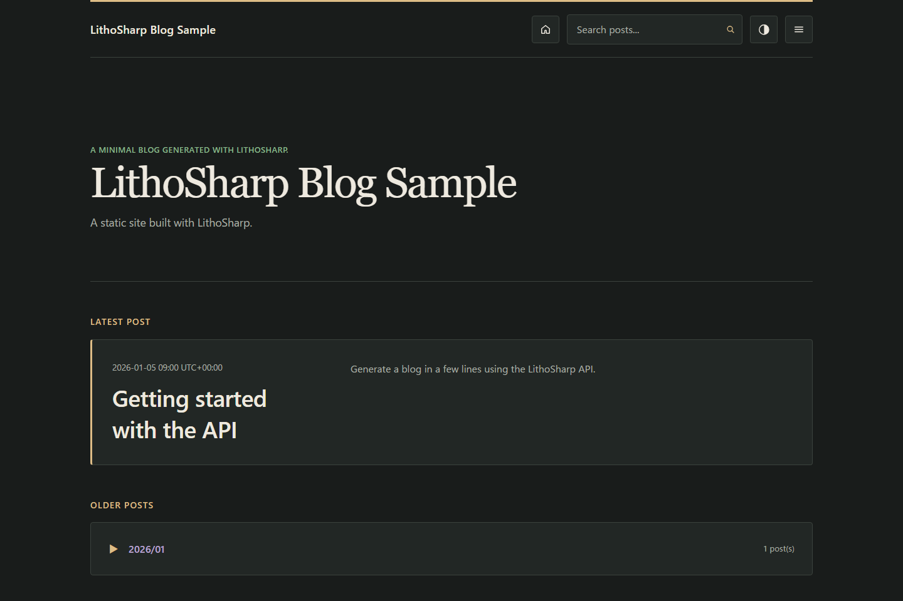

# LithoSharp Blog sample

[日本語](README.ja.md)



Theme switching is enabled by default. Set `SiteThemeOptions.EnableThemeSwitching = false`
to disable it; see the [configuration and fixed dark example](../../docs/layout-css-contract.md#theme-switching).

A minimal console app that builds a blog with [LithoSharp](../../src/LithoSharp).
It depends only on the LithoSharp library, so it doubles as a check that the generator
works without any daily-update code.

This repository sample targets LithoSharp 3.0.0. The selected Syntamark 2
runtime/Source pair and unpublished candidate state are recorded in the
[version matrix](../../eng/version-matrix.json).

## Run it

Run from the repository root with the .NET 10 SDK (10.0.300 or a later supported
feature band). No Node.js is required.

```powershell
dotnet run --project samples/LithoSharp.Sample -- --output _site
```

- `--output <dir>`: where the site is written (default: `./_site`).
- `--content <dir>`: Markdown source folder (default: the bundled `content/` next to the app).
- `--check`: inspect staged HTML, local links and anchors before publication.
- `--redirect-demo`: add the checked `old-home.html` redirect.

Open `_site/index.html` in a browser to view the result. This sample explicitly uses
`BlogSiteTemplate`, with an editorial layout for listings, archives, tags, posts and search.
Light and dark palettes follow the operating system until the reader saves a
preference with the header toggle.

## What it shows

- Reading Markdown posts with `MarkdownPostReader`.
- Validating posts with the default validator via `SiteGenerator.Validate`.
- Generating the site with `SiteGenerator.GenerateWithOptionsAsync` and a custom
  `SiteCustomization` with opt-in `llms.txt`.
- Explicit selection of `BlogSiteTemplate`.

For the default documentation layout and the full custom C# schema, generated
reference, editor and output-check workflow, see the
[Docs sample](../LithoSharp.DocsSample/README.md).

Favicon and social-image assets are optional. When no favicon directory is supplied,
LithoSharp skips those binaries and still produces a complete HTML site.

The sample exports `BlogSampleFactory : ISiteFactory`; `lithosharp build
samples/LithoSharp.Sample -o artifacts/blog-cli` and the normal `dotnet run` entry
point use the same definition. `--content`, `--output`, `--check`, and
`--redirect-demo` remain available in the sample program.

To inspect output that already exists, run from the repository root:

```powershell
dotnet run --project src/LithoSharp.Tool -- check-output --output _site --base-url https://example.com/ --format json
```

This reads the current files without rebuilding the site or proving source freshness.
Use the base URL configured in the factory if you change it. The native Markdown
path retains `lithosharp-markdown/1` with the selected Syntamark 2 pair; see
[analysis limits](../../docs/known-limitations.md#markdown-compatibility).

## Testing

Use `SiteTestHost` and `SiteTestDocument` to test the factory in the test process.

```csharp
using LithoSharp;
using LithoSharp.Testing;

await using var host = await SiteTestHost.CreateAsync(
    new BlogSampleFactory(),
    new SiteFactoryContext(Path.GetFullPath("samples/LithoSharp.Sample")));
host.AssertSucceeded();
host.AssertRoute("/index.html", "index.html");
using var page = await host.OpenPageAsync("/index.html");
page.AssertElement("main");
```

Reference this sample project and `LithoSharp.Testing` from your test project, and
run the example from the repository root. The host isolates output and caches;
external-link checks are disabled by default.
See the [testing guide](../../docs/testing.md) and [Japanese sample notes](README.ja.md).
